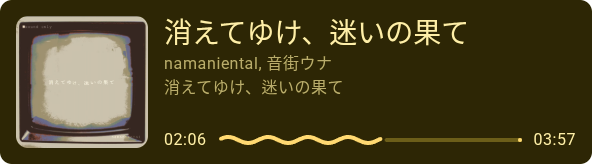

# obs-tuna-md3-widget

史上最喜爱 Material Design 之人为你呈现适用于 OBS Studio 的 [Tuna](https://github.com/univrsal/tuna) 插件的音乐挂件。



## 特点

- 尽可能与 Material Design 3 Expressive 对齐
- 自动从专辑封面采集主题颜色
- 没了！

## 使用

1. 安装 OBS Studio
2. 安装 [Tuna](https://github.com/univrsal/tuna)
3. 配置 Tuna（工具->Tuna 设置），打开「本地收发信息服务器端口」
4. 配置 Tuna 从哪里获取音乐信息
5. 启动 Tuna
6. 从 [Releases](https://github.com/MisaLiu/obs-tuna-md3-widget/releases) 下载单文件版本的挂件，添加到 OBS Studio 中（推荐尺寸 `540x164`）
7. 完成！

## 问题排查

最好使用最新开发版的 Tuna（从 [这里](https://github.com/univrsal/tuna/actions/workflows/push.yaml) 获取），正式版貌似有些问题还没来得及修。

### 不渲染封面

如果播放器向 Tuna 发送来自网络的封面地址，则挂件会优先使用它。如果在使用它时出现了一些问题，请在 Tuna 中打开「尝试下载歌曲封面」，然后打开挂件源码，将顶部的 `USE_PLAYER_PROVIDED_THUMBNAIL_URL_FIRST` 设置为 `false` 即可。

## 鸣谢

- [Preact](https://preactjs.com/)
- [matraic/m3e](https://github.com/matraic/m3e)
- [lokesh/color-thief](https://github.com/lokesh/color-thief)
- [vite](https://vite.dev/) 及其生态插件

## License

```
The MIT License (MIT)

Copyright © 2026 Misa Liu

Permission is hereby granted, free of charge, to any person obtaining a copy of this software and associated documentation files (the “Software”), to deal in the Software without restriction, including without limitation the rights to use, copy, modify, merge, publish, distribute, sublicense, and/or sell copies of the Software, and to permit persons to whom the Software is furnished to do so, subject to the following conditions:

The above copyright notice and this permission notice shall be included in all copies or substantial portions of the Software.

THE SOFTWARE IS PROVIDED “AS IS”, WITHOUT WARRANTY OF ANY KIND, EXPRESS OR IMPLIED, INCLUDING BUT NOT LIMITED TO THE WARRANTIES OF MERCHANTABILITY, FITNESS FOR A PARTICULAR PURPOSE AND NONINFRINGEMENT. IN NO EVENT SHALL THE AUTHORS OR COPYRIGHT HOLDERS BE LIABLE FOR ANY CLAIM, DAMAGES OR OTHER LIABILITY, WHETHER IN AN ACTION OF CONTRACT, TORT OR OTHERWISE, ARISING FROM, OUT OF OR IN CONNECTION WITH THE SOFTWARE OR THE USE OR OTHER DEALINGS IN THE SOFTWARE.
```